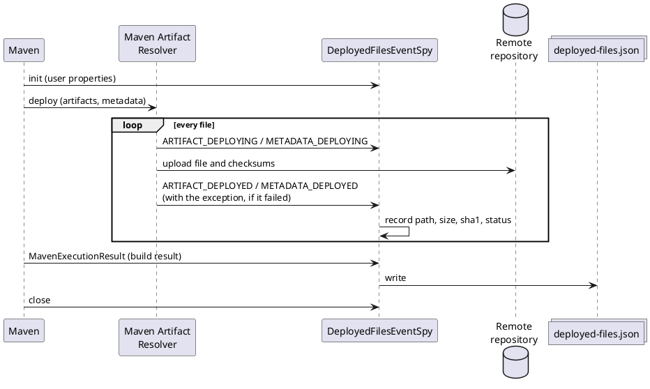

# Architecture

This page explains how the extension sees what a build deploys, and why it is built the way it is. For how to use
it see [Getting started](getting-started.md).

## The problem it solves

A step that runs after `mvn deploy`, such as copying a release to a second repository, needs to know which files
the build has published. Deriving that from the outside is unreliable:

- The modules of a reactor do not say what was deployed: a module can be skipped, and attached artifacts such as
  `-sources`, `-javadoc` or signatures are not predictable from the POM.
- The file names of a snapshot contain a timestamp and build number that only exist once Maven has deployed.
- A group id and version do not identify one build when several projects share a group id.
- A repository's search index can lag behind the uploads, so listing a version right after the deploy can return
  only part of it.

The build itself knows exactly what it uploaded. The extension writes that down.

## How it works

Maven deploys through the Maven Artifact Resolver, which reports every upload as a repository event: one when the
upload of an artifact or of a metadata file starts, one when it has ended, with the exception if it failed. Maven
forwards these events to all components of the type `EventSpy`. The extension provides one such component.

The spy keeps an upload from its start event until its end event. An upload that ended without an exception is
`deployed`, one with an exception is `failed`, and one whose end event never arrived is `incomplete` when the
list is written. The list is written when Maven reports the result of the build, which is the last event of a
build and the one that says whether the build succeeded.

All other events, such as downloads and installs into the local repository, are ignored.

### What is recorded, and when

- The **repository** (id and URL) and the **coordinates** come from the event. For a snapshot the resolver has
  already replaced `SNAPSHOT` by the timestamp and build number when the event is sent, so the list has the real
  file names.
- The **path** is built from the coordinates in the Maven 2 repository layout, the same way the resolver builds it.
- **Size and SHA-1** are read from the local file when the upload has ended, not when the list is written: the
  `maven-metadata.xml` files in the local repository can change again later in the build.
- The **checksum files** are uploaded by the resolver inside the upload of their file and have no events, so they
  are not in the list.

## Design decisions

### A core extension, loaded with `maven.ext.class.path`

Only a core extension can provide an `EventSpy`. A plugin does not receive the deploy events: it could only compute
what should have been deployed, and would not see snapshot timestamps, skipped modules or custom deploy goals.

Loading the jar with `-Dmaven.ext.class.path` keeps the projects unchanged: a pipeline can add the extension to the
one Maven call that deploys, for every project it builds. Maven finds the event spy through the index
`META-INF/sisu/javax.inject.Named` in the jar.

### Never fail the build, never slow it down

The extension observes a build whose result matters more than the list. Every entry point catches all errors, and
only the first one is logged, as a warning. The cost per file is one read of the file to hash it, right after Maven
has read the same file to upload it.

The consequence is that a missing list is not an error of the build: whoever needs the list has to check that it
exists (see [Use the list in a delivery pipeline](pipeline-how-to.md)).

### No dependencies

The jar runs inside Maven, on Maven's class path. It uses only what Maven provides (the Maven core, the resolver
API, `javax.inject`, SLF4J) and the JDK, and writes the JSON by hand. It needs Java 25 or newer, the
Java version of the jEAP libraries whose builds it was made for.

### Thread safety

A parallel build (`-T`) deploys from several threads. The recorded uploads are kept in one synchronized structure;
hashing a file happens outside the lock.

### One list per build, written atomically

The list is written once, at the end, to a temporary file that is then moved into place. A reader either sees no
list or a complete one. A build that fails partway still writes its list, with the failed and unfinished uploads
marked, so a partial deploy can be analysed.

## Related

- [jeap-deployed-files-maven-extension](../README.md)
- [Getting started](getting-started.md)
- [Use the list in a delivery pipeline](pipeline-how-to.md)
- [Configuration reference](configuration.md)
- [Format of `deployed-files.json`](deployed-files-json.md)
